

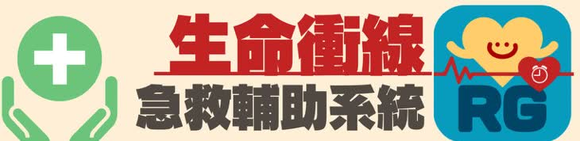

# 生命衝線：智慧急救輔助系統

### Redline Guardian

**在救護車抵達前的黃金時間，讓每一位路人都能成為可靠的救援者。**

[動機](#動機) · [功能介紹](#功能介紹) · [使用流程](#使用流程) · [使用技術](#使用技術)

---

## 動機

> 時間就是生命，時間不能逆轉，生命也不能逆轉。

黃金救援時間是指從事故發生到專業醫療介入前的關鍵幾分鐘。這段時間內若能妥善處置，可大幅提升存活率、降低後遺症風險。然而許多民眾雖然有心幫忙，卻因為缺乏急救知識而猶豫不前，錯失救援機會。

我們歸納出急救現場的五大難題，並逐一提出解法：

| 難題 | 生命衝線的解法 |
| --- | --- |
| 報案時不知道怎麼清楚回報位置與狀況 | 報案引導、定位與街景確認 |
| 無法判斷患者症狀，不知道該怎麼做 | 症狀選擇、AI 影片辨識與分級教學 |
| 找 AED 時資訊不足，到了現場卻拿不到 | AED 地圖、營業狀態與導航 |
| 不知道該送哪間醫院 | 鄰近急救責任醫院與預估車程 |
| 多人幫忙時分工混亂、重複或遺漏 | 多人協救房間、任務即時同步 |

### 與現有平台比較

| | 衛福部 AED 地圖 | 急救先鋒 | 聽見 AED | **生命衝線** |
| --- | :-: | :-: | :-: | :-: |
| 全民可用 | ✓ | ✗ | ✗ | ✓ |
| 急救教學 | ✗ | ✓ | ✗ | ✓ |
| AED 查詢 | ✓ | ✓ | ✓ | ✓ |
| CPR 姿勢判斷 | ✗ | ✗ | ✗ | ✓ |
| 症狀辨識 | ✗ | ✗ | ✗ | ✓ |
| 多人協救 | ✗ | ✗ | ✗ | ✓ |

---

## 功能介紹

### 1. 急救電話引導與街景確認

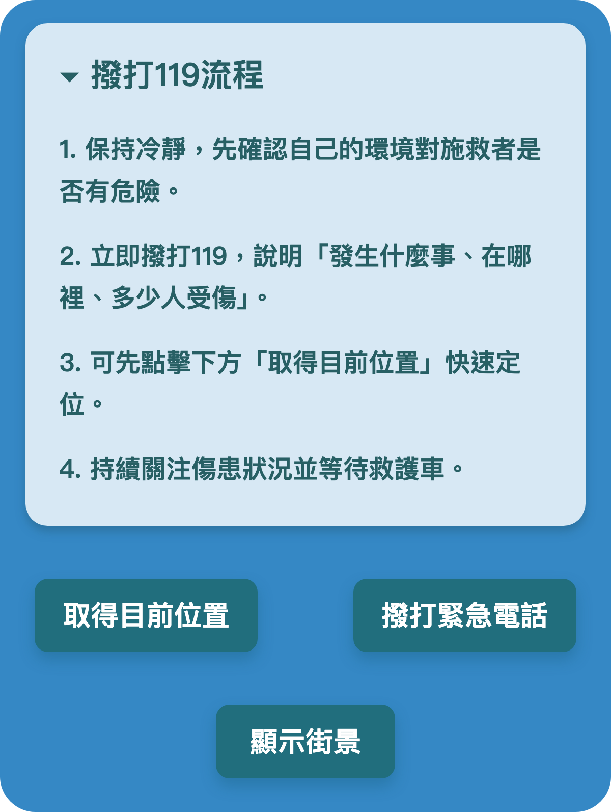

- 依步驟提醒使用者如何報案：先確認環境安全，再撥打 119 說明「發生什麼事、在哪裡、多少人受傷」
- 一鍵取得目前位置並轉換成地址，報案時可以直接念給 119 聽
- 透過街景畫面再次確認所在位置
- 一鍵撥打緊急電話

### 2. 症狀辨識與分級急救教學

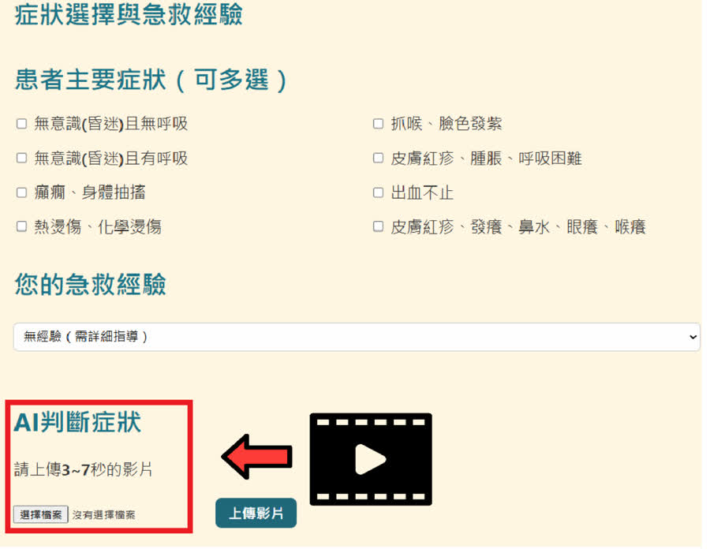

- 先確認現場環境安全，再進入症狀判斷
- 可手動勾選患者症狀，涵蓋無意識、異物哽塞、嚴重過敏、癲癇、出血不止、燙傷等常見情況
- 同時出現多種症狀時，系統會自動帶往最緊急的處置
- **AI 判斷症狀**：不確定患者狀況時，可上傳一段 3–7 秒的影片，由 AI 協助判斷
- 依使用者的急救經驗提供不同教學：沒有經驗的人看詳細圖文步驟，有經驗的人看重點提示

### 3. CPR 姿勢辨識與節拍器

<table>
<tr>
<td align="center">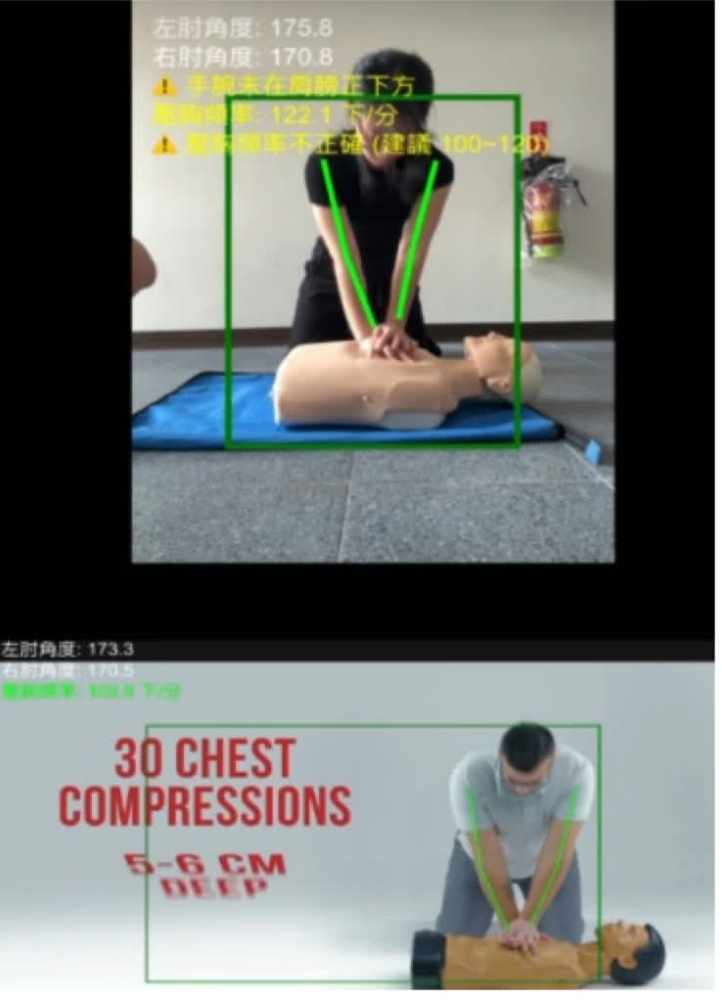 CPR 姿勢辨識</td>
<td align="center">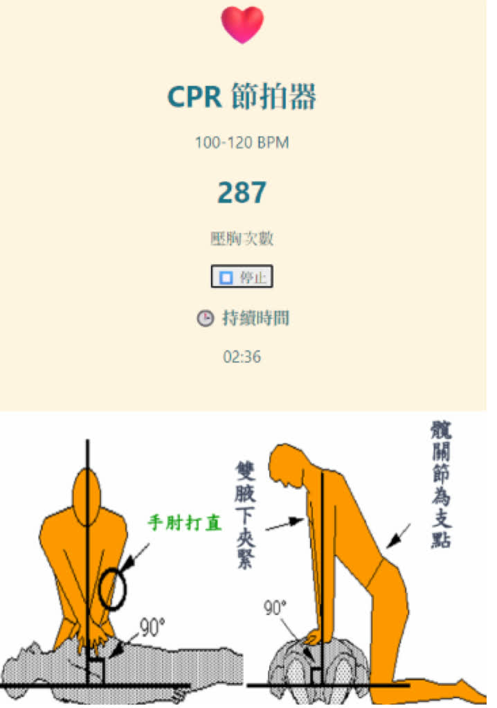 CPR 節拍器</td>
</tr>
</table>

- **姿勢辨識**：用手機鏡頭拍攝施救者，即時檢查手肘是否打直、雙手是否交疊、按壓深度與頻率是否正確，有問題就以語音提醒
- 畫面同時播放標準示範影片，沒有經驗的人也能邊看邊模仿
- **節拍器**：以聲音和畫面帶著施救者維持正確的按壓節奏，並顯示按壓次數與時間
- 每兩分鐘發出換手提示，提醒現場人員輪替，維持 CPR 品質

### 4. AED 地圖查詢

<table>
<tr>
<td align="center">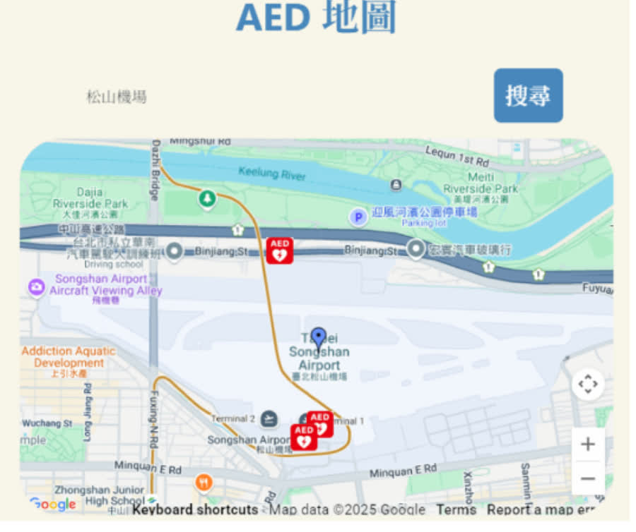 AED 地圖查詢</td>
<td align="center">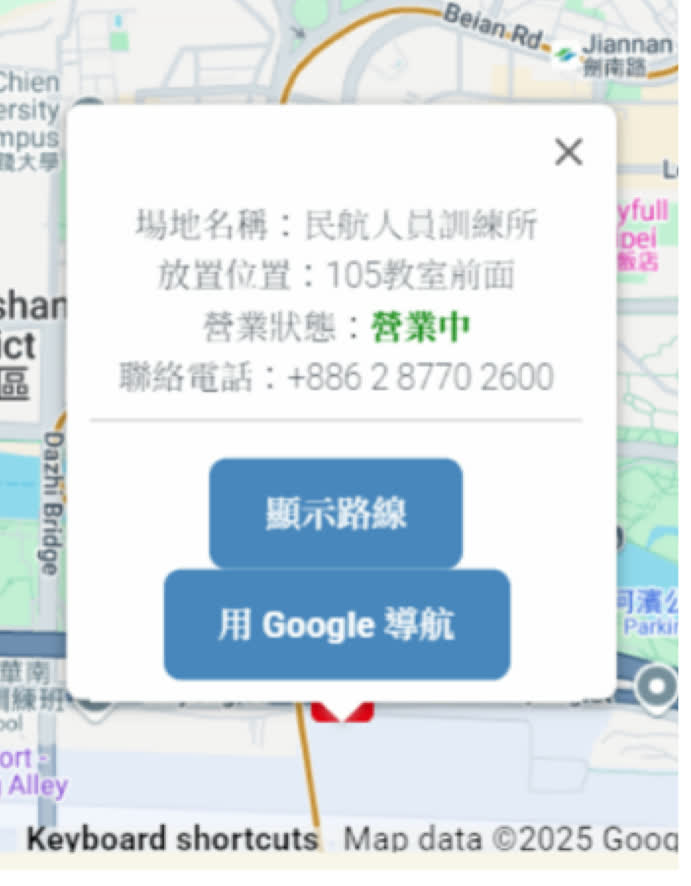 AED 地點資訊</td>
</tr>
</table>

- 自動定位，或輸入地址搜尋，列出附近最近的 AED
- 顯示場地名稱、放置位置、目前是否營業、聯絡電話，避免跑到現場才發現大門深鎖
- 一鍵顯示步行路線，或直接開啟 Google 導航
- 資料來自臺北市資料大平臺的 AED 設置場所開放資料

### 5. 急診醫院即時資訊

<table>
<tr>
<td align="center">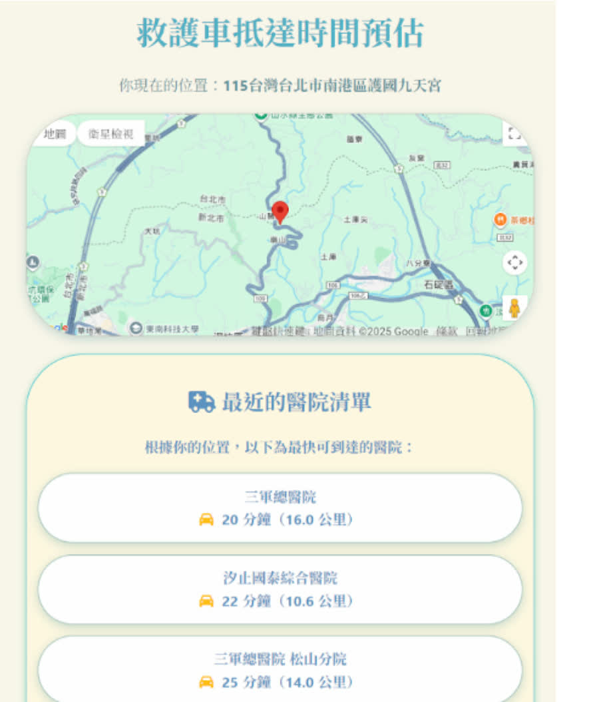 最近醫院清單</td>
<td align="center">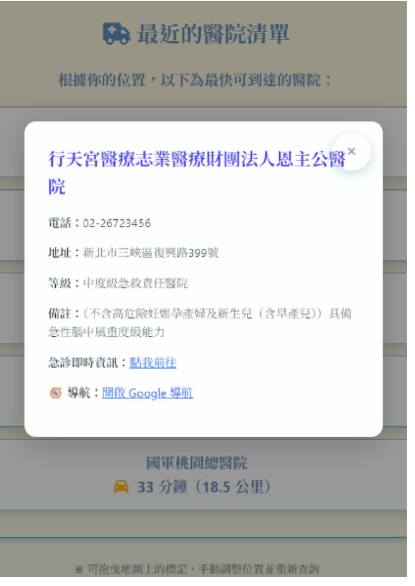 醫院詳細資訊</td>
</tr>
</table>

- 依預估車程列出最快可抵達的醫院
- 顯示醫院電話、地址與急救責任醫院等級，並標示是否適合兒童、孕產婦等特定患者
- 提供各院急診即時資訊的連結，以及 Google 導航

### 6. 多人協救房間

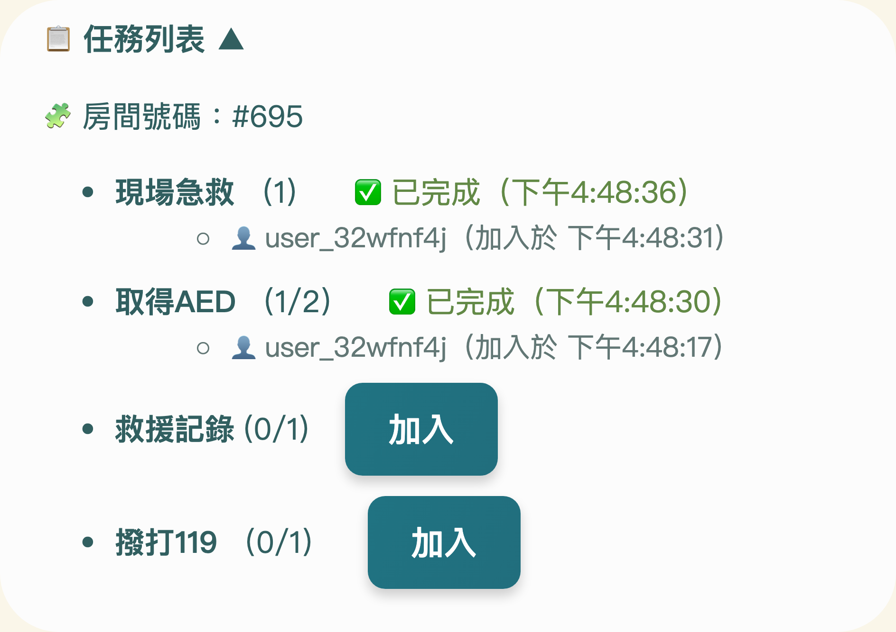

現場有多位熱心民眾時，一人建立房間，其他人輸入房號加入，再各自認領任務：

- **撥打 119**：負責報案
- **現場急救**：負責判斷症狀、執行急救
- **取得 AED**：負責找到並帶回 AED
- **救援紀錄**：負責記錄現場狀況

誰認領了什麼、何時完成，所有人的畫面都會即時同步，避免「以為有人去做，結果沒有」。

### 7. 救援事件紀錄

- 提供簡易表單，記錄事發時間、地點、患者症狀、已採取的措施與現場照片
- 依填寫者與患者的關係，分為親友家屬版（較詳盡）與一般民眾版（較簡易）
- 資料同步到雲端，方便後續醫護人員快速了解狀況、銜接處置

---

## 使用流程

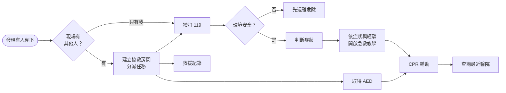

---

## 使用技術

| 類別 | 技術 |
| --- | --- |
| 前端 | React、Vite |
| 後端與資料庫 | Node.js、Firebase |
| AI 與影像 | Azure OpenAI、MediaPipe |
| 地圖服務 | Google Maps Platform |
| 開放資料 | 臺北市 AED 自動體外心臟去顫器設置場所 |

本系統為網頁應用，不需安裝，只要有可以上網的手機或電腦就能使用；若裝置有鏡頭與定位功能，還能使用症狀影像辨識與 CPR 姿勢辨識。

---

## 免責聲明

本系統僅作為急救過程的輔助工具，AI 辨識與姿勢判斷結果僅供參考，不能取代專業醫療判斷。遇到緊急狀況請立即撥打 119，並遵從救護人員指示。
